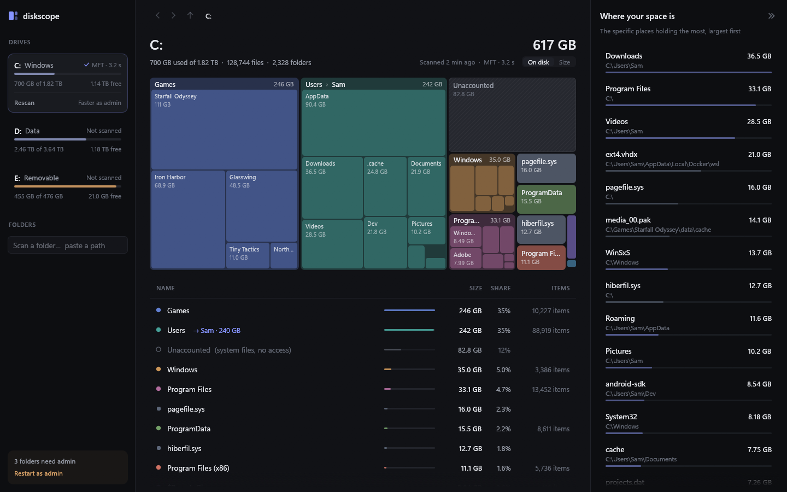
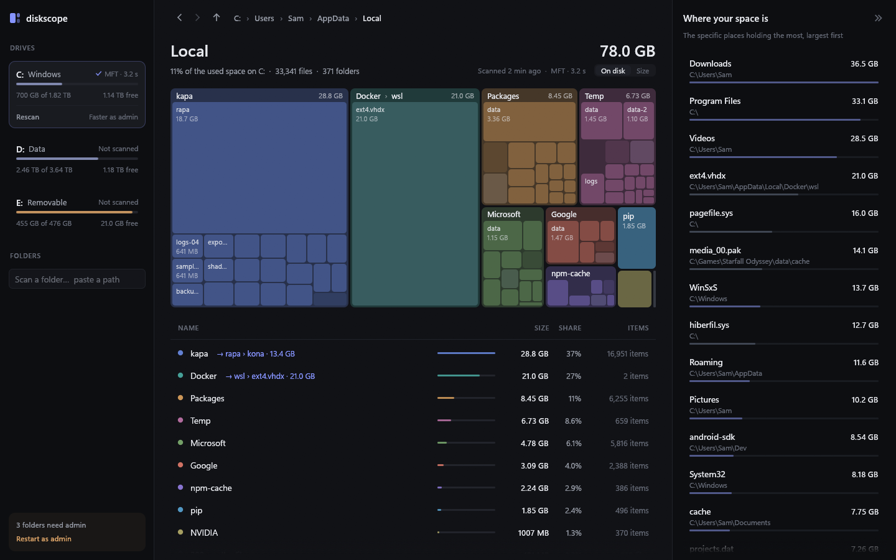
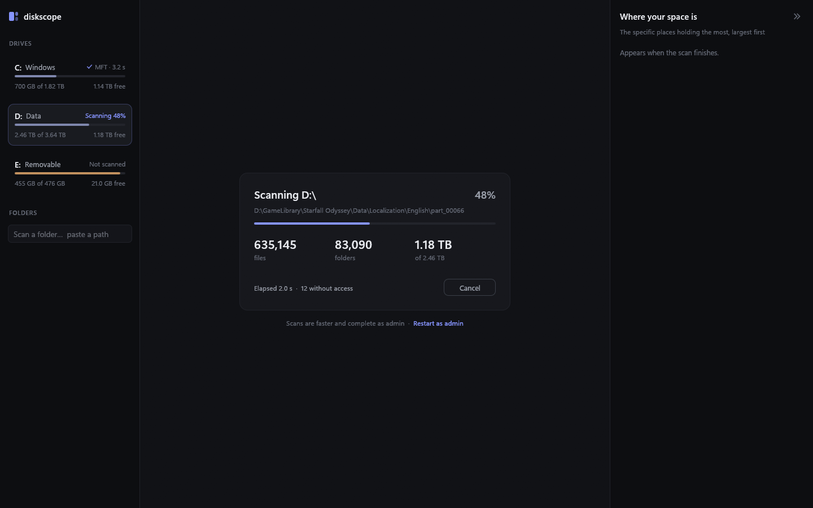

# Diskscope

Diskscope shows where the space on a Windows drive goes. It draws a treemap and a sorted list
of the current folder, you click down through the folders, and a side panel lists the specific
folders and files that hold the most space.



The screenshots use the built-in demo data (`diskscope --demo`), not a real drive.

## What makes it different

Most disk tools rank folders by total size. That puts `Users` or `AppData` at the top, and you
still have to dig to find what inside them is big. Diskscope does that digging for you.

**The "Where your space is" panel.** Diskscope walks down from the root and splits a folder
whenever one child holds a large share of it, so the list stops at the folder that holds the
space. Say `kapa` holds 30 GB, 20 GB of it sits in `kapa\rapa`, and 14 GB of that sits in
`kapa\rapa\kona`. Other tools list `kapa 30 GB`. Diskscope lists `kona 14 GB`, then the other
large subfolders by name. Whatever is left of `kapa` after that appears as `rest of kapa` in a
quieter section below. No two entries overlap, so nothing is counted twice.

**Shortcut hints in the folder list.** When one subfolder holds at least half of a folder, the
folder's row points past it. The hint keeps following the chain down while each step holds at
least half, so the `kapa` row reads `→ rapa › kona · 13.4 GB`. Clicking the hint opens `kona`.



**It reads the NTFS master file table.** Run as administrator on an NTFS drive, Diskscope reads
the drive's file table (the MFT) straight from the volume instead of opening every folder. A
full drive takes seconds. Without admin rights, or for a single folder or a FAT/exFAT drive, it
walks the folders on many threads at once instead, and the sidebar offers "Restart as admin".

**It counts what deleting would free.** The default "On disk" measure counts the space files
occupy. NTFS-compressed and sparse files count their real footprint, OneDrive online-only files
count 0, and a file with several hard links counts once. The "Size" toggle switches to file
lengths as Explorer shows them. At a drive root, an "Unaccounted" tile shows the gap between the
drive's used space and what the scan found, which is system files and folders you can't read.

## More

- The treemap nests one level of subfolders inside each tile. Hover a tile for its full path,
  size and share.
- Every scan stays in memory, so switching between drives is instant.
- Right-click a row to open it in Explorer, show it in Explorer or copy its path.
- An optional per-user install adds "Analyze with Diskscope" to the Explorer right-click menu of
  folders and drives.
- `diskscope --cli` prints a text report without opening a window.
- Diskscope never follows symlinks or junctions, so it never counts a folder twice or loops.
- It is one `.exe` with no installer and no runtime. The only file it writes is
  `%APPDATA%\diskscope\settings.txt`, which remembers the size measure.



## Download

Get `diskscope.exe` from the [releases page](https://github.com/aaljman/diskscope/releases) and
run it. It needs Windows 10 or 11 (64-bit).

The exe is not code-signed, so Windows SmartScreen may warn the first time you run it. Click
"More info", then "Run anyway", or build it yourself from source.

## Usage

```
diskscope [path]
```

Given a path (`C:`, `D:\Games`, ...), Diskscope starts scanning it right away.

| Input | Action |
|---|---|
| Click a drive | Select it, and scan it the first time |
| Click a tile or a folder row | Open that folder (a file tile opens its folder and selects the file) |
| Click a `→ a › b` hint on a row | Jump to the end of that chain |
| Click an entry in "Where your space is" | Go to it |
| Right-click a row | Open in Explorer, Show in Explorer, Copy path |
| Up / Down, Enter, Esc | Select a row, open the selected folder, clear the selection |
| Alt+Left, Backspace, mouse back button | Back |
| Alt+Right, mouse forward button | Forward |
| Alt+Up | Up one folder |
| F5 | Rescan |

### Command line report

```
diskscope --cli <path> [--top N] [--depth N] [--out report.txt] [--method auto|mft|walk]
```

This scans without opening a window. It prints a summary, the largest children of the root with
their chains, and the "Where your space is" list.

| Option | Meaning |
|---|---|
| `--top N` | Rows per folder (default 20) |
| `--depth N` | Levels of children to list (default 1) |
| `--out FILE` | Write the report to a UTF-8 file instead of the console |
| `--method` | Force the MFT reader or the folder walk (default `auto`) |

## Build from source

You need a current stable Rust toolchain and the MSVC build tools.

```powershell
.\build.ps1       # cargo build --release, then copies diskscope.exe next to the scripts
.\install.ps1     # optional: Start-menu shortcut and the Explorer menu entry, no admin needed
.\uninstall.ps1   # removes both
```

`install.ps1` puts its registry entries under `HKCU\Software\Classes` only, and it is safe to
run again. Both scripts use the `diskscope.exe` next to them, so run `build.ps1` first. On
Windows 11 the menu entry is under "Show more options".

`build.rs` embeds the icon, the application manifest and the version info with `rc.exe` from the
Windows SDK. If it can't find `rc.exe`, the build still succeeds without them and prints a
warning. `assets\make_icon.py` (needs Pillow) regenerates the icon.

`cargo test` runs the unit tests, including the MFT parser against NTFS volumes the tests build
in memory. [ARCHITECTURE.md](ARCHITECTURE.md) describes how the scanner and the hotspot list
work.

## License

Public domain, under [the Unlicense](LICENSE). Use it for anything, no credit needed.
